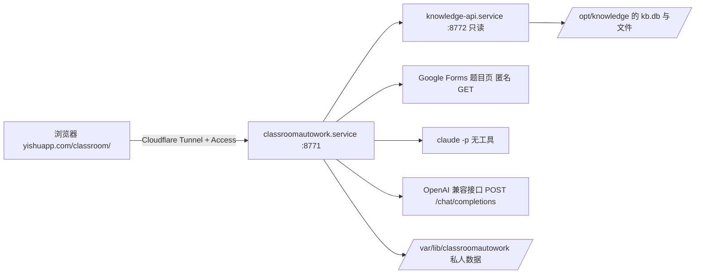

# classroomautowork

在小主机上运行的 Classroom 作业助手。网页集成在 `yishuapp.com/classroom/`：筛选待办作业，点击“一键完成”，由所选的模型接口（Claude API，或任意 OpenAI 兼容接口）读取课程资料并作答，结果进入“待审阅”，可打开答案、下载 Word 或打开预填好的原表单，最后由你核对修改并手动提交。

2.0 与旧版的区别：

- **数据来源**：不再自己登录 Google 抓取 Classroom 和 Drive，也不再用 Buzz 转录录像。题目、资料、公告、录像转写和画面文字全部来自小主机上的课程本地化工作流（`/opt/knowledge`），通过它的只读接口 `knowledge-api` 读取。两边是独立的服务，助手读不到 `/opt/knowledge` 目录本身。
- **作答模型**：不再依赖 Codex。默认每份作业调用一次本机的 Claude Code（`claude -p`），没有任何工具，只把资料当数据返回结构化结果，由本程序核验，按 Claude API 用量计费。也可以在网页的“设置 → 模型接口”改用 OpenAI 兼容接口（OpenAI、DeepSeek、通义千问、Gemini、本机 Ollama 等）：同样一次请求、同样的结构化结果和本地核验。密钥都在“设置”里填写和更换。
- **运行位置**：常驻 systemd 服务，不再是 Windows 桌面程序；Windows 启动器、自动关机、Codex 会话审批和浏览器代读题目都已删除。

## 组成



| 部分 | 位置 | 说明 |
| --- | --- | --- |
| 作业助手 | `/opt/classroomautowork`，`classroomautowork.service` | 本仓库。只监听 `127.0.0.1:8771` |
| 课程数据接口 | `/opt/knowledge/api/server.py`，`knowledge-api.service` | 属于课程本地化工作流，不在本仓库。说明见 `/opt/knowledge/AUTOUPDATE.md` |
| 私人数据 | `/var/lib/classroomautowork` | 设置、任务记录、资料包、答案。不进入 Git |

## 一次处理的流程

1. **刷新作业**：从 `knowledge-api` 读取所有课程的作业和本人提交状态。资料库多久抓取一次 Classroom，这里就有多新（目前每小时）。
2. **准备资料**：对选中作业所在课程，读取全部历史作业、资料、公告，以及资料库里该课程的文档、笔记和录像转写，写入本机检索库。资料库里缺失或还没处理完的附件、录像列为资料缺口。同时把 PDF 和课件（PPT）渲染成页面图片：当前作业附带的文件每一页都渲染，其他资料只渲染以图片、图表或扫描为主的页面；完全没有文字的页面会单独作为一条证据。
3. **读取表单**：作业里的 Google Forms 链接仍由助手匿名读取题目（资料库不保存表单题目）。需要学校登录的表单会列为缺口，可在“调整答案或说明”里手动导入题目数据。
4. **作答**：把原题、按相关度排序的课程资料（最多约 10 万字）和最多 60 张页面图片发给所选模型（每张图前注明出自哪份资料哪一页；超出上限的会在提示里列出），要求返回固定 schema 的 JSON。答案为空、格式错误或表单栏位不全时，用同一接口、同一模型自动补一次；OpenAI 兼容接口的请求本身失败（限流、余额、请求过大、接口出错、连接中断、超时）不补，因为马上重发也一样，等原因消除后点“重试未完成”。
5. **核验与交付**：本地检查证据 ID、直接引文和个人事实，生成 `draft.md`、检查表和 `answer.docx`。有表单时生成原生预填链接；程序从不提交，也不写 Classroom。

## 模型接口

“设置 → 模型接口”在 **Claude API**（默认）和 **OpenAI 兼容** 之间切换，保存在 `data_dir/model-provider.json`（`{provider: "anthropic" | "openai"}`，文件不存在即 Claude）。切换后工具栏的模型列表随之改变；每个任务开始时记下所用接口，之后的重试也用它，进行中的任务不受切换影响。填写任务（“保存并带入表单”）本身不调用模型，它的重试需要重新作答时用当前的接口。OpenAI 兼容接口要先保存并验证才能切换过去；删除它的设置会自动改回 Claude API。两个设置文件的写入互斥：验证期间设置被删除或改动时，这次保存会被拒绝，不会把删除的设置写回来。

## Claude 调用

- 命令：`claude -p --bare --input-format stream-json --output-format stream-json --tools "" --disallowedTools "mcp__*" --no-session-persistence --json-schema …`。启动时检查使用的是 API 密钥、实际模型与所选一致、没有额外工具，否则停止。
- 模型在“设置”里选择：Opus 5.5、Sonnet 5.5（默认，强度 high）、Haiku 5.5、Fable 5.1。
- 单次回合最长 15 分钟，连续 5 分钟没有输出即停止；结果超过 64,000 字符不接受。
- **计费**：只用 Claude API 密钥。`--bare` 不读取这台机器上的 Claude 登录，所以没有密钥时不会退回订阅额度，而是直接停止并提示去设置里填写。
- **密钥**：在网页“设置 → Claude API 密钥”填写。保存前用 Anthropic 的模型列表接口验证（不消耗 token），通过后存为 `data_dir/anthropic-api-key.json`（只有 root 可读），之后只显示末尾 4 位和更新时间，完整密钥不会再返回给网页。换密钥直接重新填写，删除后不能作答。保存后下一次作答立即生效，不用重启服务。

## OpenAI 兼容接口

- **设置**：网页“设置 → 模型接口 → OpenAI 兼容”填写三项。**接口地址**是 `/chat/completions` 之前的部分，例如 `https://api.example.com/v1`、`https://api.deepseek.com`、`https://dashscope.aliyuncs.com/compatible-mode/v1`、`https://generativelanguage.googleapis.com/v1beta/openai`、`http://127.0.0.1:11434/v1`；只接受 http/https，不能带用户名密码、`?` 或 `#`；主机名只能是字母、数字、点、`-` 和 `_`，IP 地址只接受 `127.0.0.1` 这样的四段十进制（`127.1`、`2130706433`、`0x7f.0.0.1` 不接受）；末尾的 `/` 和误贴的 `/chat/completions` 会去掉，但程序不会自己补 `/v1`。**密钥**以 `Authorization: Bearer` 发送；地址的协议、主机和端口都不变时可以留空沿用已保存的密钥，否则必须重填。**模型**填一个或多个名称（逗号或换行分开，第一个是默认，最多 20 个，只能用字母、数字和 `. _ : / @ + -`）；看起来像密钥的名称会被拒绝，且不回显。
- **验证**：保存前 `GET {接口地址}/models`（整个验证最多 20 秒，按墙钟计，不是每次读取各 20 秒；不跟随跳转）。200 就保存，并记下接口列出的模型（最多 500 个，去掉像密钥的 id）作为输入建议，所填模型不在列表里时照样保存并提示；随后不带密钥再请求一次同一地址，仍然返回 200（OpenRouter、本机服务等的模型列表是公开的）就提示“密钥要到作答时才能确认”，而不是“已验证”；401/403 拒绝、不保存；404/405 说明接口没有模型列表，照样保存，密钥和模型要到作答时才能确认；连不上、超时、5xx 或返回的不是 JSON 都不保存。
- **保存位置**：`data_dir/openai-compatible.json`（`base_url`、`api_key`、`models`、接口列出的模型和更新时间），和 Claude 密钥一样只有属主可读。网页和任何接口只返回主机、模型和密钥末尾 4 位（较短的密钥连末尾也不显示）。用 http 连外网地址时设置里会提示密钥是明文发送。
- **发送的内容**：每份作业一次 `POST {接口地址}/chat/completions`：一条 user 消息，内容是和 Claude 相同的提示与资料文字（题目、课程资料，以及设置里的学生资料（姓名、学号等）、补充说明和个人事实），外加一行写明本次作答的模型和接口主机、写 AI 使用说明时要写这个模型而不是 Claude（Claude 的提示词不变），再加上页面图片（`image_url` 的 `data:image/png;base64,…`；没有图片时整段文字作为一个字符串）；`response_format` 为 `json_schema`（`strict: true`，schema 与 Claude 路径相同）；`stream: true` 并要求 `include_usage`；选了推理强度（低/中/高）才发送 `reasoning_effort`，“默认”不发送。
- **兼容降级**：接口以 400/422 拒绝某项功能时（包括 200 回复里带的 `code: 400` 错误），去掉这一项后原样重发，每一步最多一次：先 `reasoning_effort`（错误点名这个参数（也认 `reasoningEffort`、`thinking_config`），或说模型不支持 thinking / reasoning 时，例如 Ollama 的 “does not support thinking”；只是顺带提到 reasoning tokens 的不算），再 `stream_options`，`json_schema` 改成 `json_object`（也认 Gemini 的 `response_schema`）、再改成只靠提示词（这两步都在提示里附上 schema，并能从 ```json 代码块或文字里取出 JSON 对象），页面图片（改发文字说明，列出没发送的页），最后改成不流式。请求太长或太大（413，或 400 说上下文长度、`payload size`、图片太多）时先于上面各步判断，不按功能降级：带着页面图片就先去掉页面图片重发一次，否则直接报长度或大小错误。不流式的 `application/json` 回答和以工具调用（`tool_calls`）返回的答案也接受。结果一律在本机按 schema 核验（整数写成 `1.0` 也算整数），再走和 Claude 相同的证据与引文核验。
- **限时与暂停**：和 Claude 一样，单次回合最长 15 分钟，连续 5 分钟没有任何输出即停止，错误里写明是哪一种；暂停会立即断开连接。
- **错误**：密钥被拒（401/403）、地址或模型不存在（404）、余额不足（402）、限流（429）、超出模型能读的长度、超出请求大小（413）、接口出错（5xx）、地址返回的是网页、回复格式不对、输出被截断（`finish_reason: length`）、内容审核拦截、模型拒答、JSON 无法解析或不符合 schema，都会写明原因和处理办法；接口自己的原话放在下一行，截短并去掉任何像密钥的内容（8 个字符以下的占位“密钥”只在单独出现时隐藏，不会把原话里的单词弄乱）。接口在成功时返回的回复 id、模型名、结束原因和列出的模型 id 也同样去掉密钥。
- **记录**：`generation.json` 记录 `provider: openai_compatible`、接口主机（只记主机，从不记录密钥）、所选模型和接口报告的模型、结构化输出方式、发送和省略的页图数量（省略时答案面板也会提示）、降级步骤（`images` 为接口不接受图片，`images_size` 为请求太大）、用量（`prompt_tokens` 等换算成与 Claude 相同的 `input_tokens`/`output_tokens`/`cache_read_input_tokens`）和用时。接口不报告费用，“记录”页的费用显示“—”。

## 部署

渲染课件页面需要 LibreOffice 和日文字体（否则页面里的日文会变成方块）：

```bash
apt-get install --no-install-recommends libreoffice-impress-nogui fonts-noto-cjk
```

```bash
cd /opt/classroomautowork
uv sync --frozen
CLASSROOMAUTOWORK_HOME=/var/lib/classroomautowork .venv/bin/classroomaw --config /var/lib/classroomautowork/settings.json init --data-dir /var/lib/classroomautowork/data
systemctl enable --now knowledge-api classroomautowork
```

`settings.json` 的主要字段：`data_dir`、`timezone`（默认 Asia/Tokyo）、`kb_url`（只能是本机地址）、`kb_token_file`（默认 `/etc/knowledge-api/token`）。`school_email` 和 `client_json` 只在以后启用 Google 文档自动填写时需要。

学生身份放在 `data_dir/student-profile.json`，字段为 `student_id`、`name`、`department`、`class_name`，每次作答都会传给模型，课程内容不能覆盖它。

`yishuapp.com/classroom/` 需要在 Cloudflare Zero Trust 的 Tunnel 里加一条公开主机名：域名 `yishuapp.com`，路径 `classroom`，服务 `http://127.0.0.1:8771`，并排在整个域名指向状态页的那条之前。公网请求没有 Cloudflare Access 的请求头会被直接拒绝（403），与状态页的规则相同；写操作还要求 `Origin` 是 `https://yishuapp.com`。本机访问（SSH 隧道）仍用 `data_dir/ui/server.json` 里的随机令牌。

## 课程规则与个人事实

每门课的“课程规则”可以记录教师的 AI 规定、来源、允许用途和你的真实个人事实，保存在 `data_dir/courses/<课程ID>.json`。按你的要求，课程的 AI 禁止或限制只作为说明记录在审阅提示里，不阻止已勾选的生成；程序也不会声称教师允许。个人经历、出席、观看、调查和健康数值只用你提供的事实，缺少时相应栏位留空并写进审阅提示。

## 尚未包含

- **自动填写个人 Google 文档**：需要单独的 Google Docs 写入授权，放在后续版本。代码（`document_fill.py`、`auth.py`）保留，网页上的入口暂时隐藏；现在请打开答案或下载 Word 审阅。
- 资料库目前只记录本人的提交状态，不含提交附件，所以“学生自己的作业副本”只能用教师的学生副本模板代替。

## 开发

```bash
uv sync --extra dev --frozen
.venv/bin/ruff check src tests scripts skills
.venv/bin/ruff format --check src tests scripts skills
.venv/bin/pytest -q
.venv/bin/python scripts/check_publication.py
```

离线测试用替身代替 `knowledge-api`、`claude` 和 OpenAI 兼容接口（`127.0.0.1` 上的本地假服务），不能证明真实模型或资料库可用。模块说明见 [docs/architecture.md](docs/architecture.md)。
