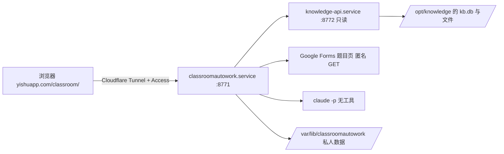

# classroomautowork

在小主机上运行的 Classroom 作业助手。网页集成在 `yishuapp.com/classroom/`：筛选待办作业，点击“一键完成”，由 Claude 读取课程资料并作答，结果进入“待审阅”，可打开答案、下载 Word 或打开预填好的原表单，最后由你核对修改并手动提交。

2.0 与旧版的区别：

- **数据来源**：不再自己登录 Google 抓取 Classroom 和 Drive，也不再用 Buzz 转录录像。题目、资料、公告、录像转写和画面文字全部来自小主机上的课程本地化工作流（`/opt/knowledge`），通过它的只读接口 `knowledge-api` 读取。两边是独立的服务，助手读不到 `/opt/knowledge` 目录本身。
- **作答模型**：不再依赖 Codex。每份作业调用一次本机的 Claude Code（`claude -p`），没有任何工具，只把资料当数据返回结构化结果，由本程序核验。按 Claude API 用量计费，密钥在网页的“设置”里填写和更换。
- **运行位置**：常驻 systemd 服务，不再是 Windows 桌面程序；Windows 启动器、自动关机、Codex 会话审批和浏览器代读题目都已删除。

## 组成



| 部分 | 位置 | 说明 |
| --- | --- | --- |
| 作业助手 | `/opt/classroomautowork`，`classroomautowork.service` | 本仓库。只监听 `127.0.0.1:8771` |
| 课程数据接口 | `/opt/knowledge/api/server.py`，`knowledge-api.service` | 属于课程本地化工作流，不在本仓库。说明见 `/opt/knowledge/AUTOUPDATE.md` |
| 私人数据 | `/var/lib/classroomautowork` | 设置、任务记录、资料包、答案。不进入 Git |

## 一次处理的流程

1. **刷新作业**：从 `knowledge-api` 读取所有课程的作业和本人提交状态。资料库多久抓取一次 Classroom，这里就有多新（目前每小时）。
2. **准备资料**：对选中作业所在课程，读取全部历史作业、资料、公告，以及资料库里该课程的文档、笔记和录像转写，写入本机检索库。资料库里缺失或还没处理完的附件、录像列为资料缺口。当前作业附带的 PDF 会渲染前 12 页页图，供模型看扫描件和表格。
3. **读取表单**：作业里的 Google Forms 链接仍由助手匿名读取题目（资料库不保存表单题目）。需要学校登录的表单会列为缺口，可在“调整答案或说明”里手动导入题目数据。
4. **作答**：把原题、按相关度排序的课程资料（最多约 10 万字）和页图发给 Claude，要求返回固定 schema 的 JSON。答案为空、格式错误或表单栏位不全时，用同一模型自动补一次。
5. **核验与交付**：本地检查证据 ID、直接引文和个人事实，生成 `draft.md`、检查表和 `answer.docx`。有表单时生成原生预填链接；程序从不提交，也不写 Classroom。

## Claude 调用

- 命令：`claude -p --bare --input-format stream-json --output-format stream-json --tools "" --disallowedTools "mcp__*" --no-session-persistence --json-schema …`。启动时检查使用的是 API 密钥、实际模型与所选一致、没有额外工具，否则停止。
- 模型在“设置”里选择：Opus 5.5、Sonnet 5.5（默认，强度 high）、Haiku 5.5、Fable 5.1。
- 单次回合最长 15 分钟，连续 5 分钟没有输出即停止；结果超过 64,000 字符不接受。
- **计费**：只用 Claude API 密钥。`--bare` 不读取这台机器上的 Claude 登录，所以没有密钥时不会退回订阅额度，而是直接停止并提示去设置里填写。
- **密钥**：在网页“设置 → Claude API 密钥”填写。保存前用 Anthropic 的模型列表接口验证（不消耗 token），通过后存为 `data_dir/anthropic-api-key.json`（只有 root 可读），之后只显示末尾 4 位和更新时间，完整密钥不会再返回给网页。换密钥直接重新填写，删除后不能作答。保存后下一次作答立即生效，不用重启服务。

## 部署

```bash
cd /opt/classroomautowork
uv sync --frozen
CLASSROOMAUTOWORK_HOME=/var/lib/classroomautowork .venv/bin/classroomaw --config /var/lib/classroomautowork/settings.json init --data-dir /var/lib/classroomautowork/data
systemctl enable --now knowledge-api classroomautowork
```

`settings.json` 的主要字段：`data_dir`、`timezone`（默认 Asia/Tokyo）、`kb_url`（只能是本机地址）、`kb_token_file`（默认 `/etc/knowledge-api/token`）。`school_email` 和 `client_json` 只在以后启用 Google 文档自动填写时需要。

学生身份放在 `data_dir/student-profile.json`，字段为 `student_id`、`name`、`department`、`class_name`，每次作答都会传给模型，课程内容不能覆盖它。

`yishuapp.com/classroom/` 需要在 Cloudflare Zero Trust 的 Tunnel 里加一条公开主机名：域名 `yishuapp.com`，路径 `classroom`，服务 `http://127.0.0.1:8771`，并排在整个域名指向状态页的那条之前。公网请求没有 Cloudflare Access 的请求头会被直接拒绝（403），与状态页的规则相同；写操作还要求 `Origin` 是 `https://yishuapp.com`。本机访问（SSH 隧道）仍用 `data_dir/ui/server.json` 里的随机令牌。

## 课程规则与个人事实

每门课的“课程规则”可以记录教师的 AI 规定、来源、允许用途和你的真实个人事实，保存在 `data_dir/courses/<课程ID>.json`。按你的要求，课程的 AI 禁止或限制只作为说明记录在审阅提示里，不阻止已勾选的生成；程序也不会声称教师允许。个人经历、出席、观看、调查和健康数值只用你提供的事实，缺少时相应栏位留空并写进审阅提示。

## 尚未包含

- **自动填写个人 Google 文档**：需要单独的 Google Docs 写入授权，放在后续版本。代码（`document_fill.py`、`auth.py`）保留，网页上的入口暂时隐藏；现在请打开答案或下载 Word 审阅。
- 资料库目前只记录本人的提交状态，不含提交附件，所以“学生自己的作业副本”只能用教师的学生副本模板代替。

## 开发

```bash
uv sync --extra dev --frozen
.venv/bin/ruff check src tests scripts skills
.venv/bin/ruff format --check src tests scripts skills
.venv/bin/pytest -q
.venv/bin/python scripts/check_publication.py
```

离线测试用替身代替 `knowledge-api` 和 `claude`，不能证明真实模型或资料库可用。模块说明见 [docs/architecture.md](docs/architecture.md)。
