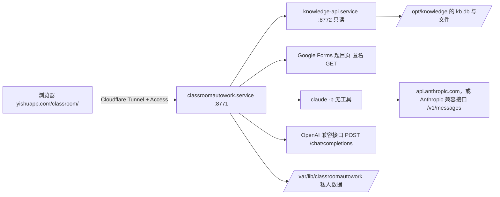

# classroomautowork

在小主机上运行的 Classroom 作业助手。网页集成在 `yishuapp.com/classroom/`：筛选待办作业，点击“一键完成”，由所选的模型接口（Claude API、Anthropic 兼容接口（例如 Claude Code 中转站），或任意 OpenAI 兼容接口）读取课程资料并作答，结果进入“待审阅”，可打开答案、下载 Word 或打开预填好的原表单，最后由你核对修改并手动提交。

2.0 与旧版的区别：

- **数据来源**：不再自己登录 Google 抓取 Classroom 和 Drive，也不再用 Buzz 转录录像。题目、资料、公告、录像转写和画面文字全部来自小主机上的课程本地化工作流（`/opt/knowledge`），通过它的只读接口 `knowledge-api` 读取。两边是独立的服务，助手读不到 `/opt/knowledge` 目录本身。
- **作答模型**：不再依赖 Codex。默认每份作业调用一次本机的 Claude Code（`claude -p`），没有任何工具，只把资料当数据返回结构化结果，由本程序核验，按 Claude API 用量计费。也可以在网页的“设置 → 模型接口”让同一个 Claude Code 连到 Anthropic 兼容接口（中转站的 `ANTHROPIC_BASE_URL`），或改用 OpenAI 兼容接口（OpenAI、DeepSeek、通义千问、Gemini、本机 Ollama 等）：同样一次请求、同样的结构化结果和本地核验。密钥都在“设置”里填写和更换。
- **运行位置**：常驻 systemd 服务，不再是 Windows 桌面程序；Windows 启动器、自动关机、Codex 会话审批和浏览器代读题目都已删除。

## 组成



| 部分 | 位置 | 说明 |
| --- | --- | --- |
| 作业助手 | `/opt/classroomautowork`，`classroomautowork.service` | 本仓库。只监听 `127.0.0.1:8771` |
| 课程数据接口 | `/opt/knowledge/api/server.py`，`knowledge-api.service` | 属于课程本地化工作流，不在本仓库。说明见 `/opt/knowledge/AUTOUPDATE.md` |
| 私人数据 | `/var/lib/classroomautowork` | 设置、任务记录、资料包、答案。不进入 Git |

## 一次处理的流程

1. **刷新作业**：从 `knowledge-api` 读取所有课程的作业和本人提交状态。资料库多久抓取一次 Classroom，这里就有多新（目前每小时）。
2. **准备资料**：对选中作业所在课程，读取全部历史作业、资料、公告，以及资料库里该课程的文档、笔记和录像转写，写入本机检索库。资料库里缺失或还没处理完的附件、录像列为资料缺口。同时把 PDF 和课件（PPT）渲染成页面图片：当前作业附带的文件每一页都渲染，其他资料只渲染以图片、图表或扫描为主的页面；完全没有文字的页面会单独作为一条证据。
3. **读取表单**：作业里的 Google Forms 链接仍由助手匿名读取题目（资料库不保存表单题目）。需要学校登录的表单会列为缺口，可在“调整答案或说明”里手动导入题目数据。
4. **作答**：把原题、按相关度排序的课程资料（最多约 10 万字）和最多 60 张页面图片发给所选模型（每张图前注明出自哪份资料哪一页；超出上限的会在提示里列出），要求返回固定 schema 的 JSON。答案为空、格式错误或表单栏位不全时，用同一接口、同一模型自动补一次；请求本身失败（密钥被拒、找不到模型、输出上限被拒、限流、余额、请求过大、接口出错、连接中断、OpenAI 兼容接口的超时）不补，因为马上重发也一样，等原因消除后点“重试未完成”。
5. **核验与交付**：本地检查证据 ID、直接引文和个人事实，生成 `draft.md`、检查表和 `answer.docx`。有表单时生成原生预填链接；程序从不提交，也不写 Classroom。

## 模型接口

“设置 → 模型接口”是一个三选一的列表（iOS 设置的勾选样式；三个名字放进分段控件在 390px 宽的手机上放不下）：**Claude API**（默认）、**Anthropic 兼容**、**OpenAI 兼容**，保存在 `data_dir/model-provider.json`（`{provider: "anthropic" | "anthropic_compatible" | "openai"}`，文件不存在即 Claude API）。切换后工具栏的模型列表随之改变；每个任务开始时记下所用接口，之后的重试也用它，进行中的任务不受切换影响。点“完成”和“保存并重做”时页面一并发送它列出的是哪个接口的模型（`provider`）；在别的页面或设备上已经切换了接口时，服务端拒绝开始（“模型接口已在别处切换为 …，请重新选择模型后再点完成”），不会用另一个账户计费；页面下次读取状态时发现接口已切换，也会重新读取工具栏的模型列表。填写任务（“保存并带入表单”）本身不调用模型，它的重试需要重新作答时用当前的接口。两个兼容接口都要先保存并验证才能切换过去（选中还没保存的那一个时，只显示它的表单和“作答仍使用 …”的提示，保存成功后才切换）；删除正在使用的那个会自动改回 Claude API，删除另一个不影响当前接口。设置文件的写入互斥：验证期间设置被删除或改动时，这次保存会被拒绝，不会把删除的设置写回来。

**输出上限**（可选，三个接口各自设置）：1000–1000000 之间的整数（单位 tokens，推理用的 token 也算在内），留空就不设；`16k`、`16,000`、小数和超出范围的值都会被拒绝，什么也不保存。OpenAI 兼容接口以 `max_tokens` 发送（见下）；两个 Claude 接口只在设置了时才给 Claude Code 加上环境变量 `CLAUDE_CODE_MAX_OUTPUT_TOKENS=N`，Claude Code 把它作为请求的 `max_tokens` 发送（已用真实 CLI 对本机假服务核对）。Claude API 的上限存在单独的 `data_dir/claude-settings.json`（0600），密钥文件的格式不变。

**测试连接**：每个接口的设置里都有“测试连接”（已保存的接口才能点），按作答完全相同的路径发一次很短的真实请求：一句话、一张程序生成的 16×16 小图和只有 `ok`、`reply` 两个字段的 schema。OpenAI 兼容接口不发送推理强度（“默认”），两个 Claude 接口用 `low`；已保存的输出上限照样生效；整个测试最多 120 秒，连续 60 秒没有输出即停止，会用掉少量 token。结果直接显示在这一组里：用时、接口报告的模型、用量（Claude 接口还有 Claude Code 估算的费用），以及接口不接受的东西（图片、JSON Schema、流式、输出上限参数、超过最大值的输出上限），这些也就是作答时会降级的地方；回复不是单独的 JSON、要从文字或代码块里找出时，提示接口似乎没有按 JSON Schema（`response_format`）约束输出（今天“结果 缺少字段 summary”的原因），格式不符而失败时也这样提示。失败时写明原因和办法，接口原话在下一行；措辞和作答的错误相同，只是去掉“未作答”“资料已保留”和“请在设置 → … 里”（测试就是在那里点的）；失败的结果也写明主机和所测的模型。Anthropic 兼容接口的测试只让 Claude Code 重试一次（`CLAUDE_CODE_MAX_RETRIES=1`），所以密钥被拒、额度用尽、没有可用渠道等几秒内就有结果，并带着中转站自己的原话；作答保持 Claude Code 默认的重试。页面不再等待（关闭、刷新，或 135 秒后放弃）时测试随之停止，连同它的 Claude Code 进程，不再占着“正在测试”，结果也不保存；服务停止时同样。同一时间只能有一次测试（再点会得到 409）。每个接口的上次结果存在 `data_dir/connection-tests.json`（`{at, ok, model, summary}`，0600，不含密钥），显示为“上次测试：正常 · 2.1 秒 · 17:40”，有降级时写在里面（“正常 · 不接受图片 · 2.1 秒”）；保存或删除这个接口的设置（Claude API 是密钥或输出上限）后清空。接口是 `POST /api/settings/test {provider, model?}`，和其他写操作一样要求本机令牌或 Cloudflare Access 加 `Origin`。经 Cloudflare Tunnel 访问时，超过约 100 秒的测试会被 Cloudflare 先断开（524）。

## Claude 调用

- 命令：`claude -p --bare --input-format stream-json --output-format stream-json --tools "" --disallowedTools "mcp__*" --no-session-persistence --json-schema …`。启动时检查使用的是 API 密钥（或 Anthropic 兼容接口的密钥助手）、实际模型与所选一致、没有额外工具，否则停止。Claude Code 以名为 `StructuredOutput` 的工具调用返回结构化结果，CLI 自己核对 schema；本机 2.1.318 版在这次工具调用后就结束，不再发后续请求。
- 模型在“设置”里选择：Opus 5.5、Sonnet 5.5（默认，强度 high）、Haiku 5.5、Fable 5.1。
- 单次回合最长 15 分钟，连续 5 分钟没有输出即停止；结果超过 64,000 字符不接受。
- **计费**：只用 Claude API 密钥。`--bare` 不读取这台机器上的 Claude 登录，所以没有密钥时不会退回订阅额度，而是直接停止并提示去设置里填写。
- **密钥**：在网页“设置 → 模型接口 → Claude API”填写。保存前用 Anthropic 的模型列表接口验证（不消耗 token），通过后存为 `data_dir/anthropic-api-key.json`（只有 root 可读），之后只显示末尾 4 位和更新时间，完整密钥不会再返回给网页。换密钥直接重新填写，已保存密钥时只改输出上限可以把密钥留空，删除后不能作答。保存后下一次作答立即生效，不用重启服务。`PUT /api/settings/api-key` 接受 `{key?, max_output_tokens?}`。
- **没有设置任何新选项时**（没有输出上限、用的是 Claude API），传给 Claude Code 的参数和环境变量与以前逐字相同。
- **密钥被拒**：Claude Code 遇到 401/403 会自己重试约 10 次、持续三分钟左右；作答时程序在它第一次报告重试（`api_retry`，`error_status` 401/403）时就停止并写明密钥被拒。这个事件只带类别（`authentication_failed`），中转站的原话要等 Claude Code 的结果；连接测试只重试一次并等到结果，所以能看到原话（Anthropic 自己的 `authentication_error` 由 Claude Code 改写成 “Invalid API key · Fix external API key”，new-api 等中转站的原话照样传出）。其他重试（429、5xx）只更新进度文字；回合时限到时还在重试的，写明“接口连续返回 HTTP 503，Claude Code 重试 N 次仍未成功”，而不是“没有任何输出”。
- **输出上限被拒**：接口以 “max_tokens: N > M, which is the maximum allowed number of output tokens …” 拒绝时（没设上限时 Claude Code 自己的默认值也可能被拒，例如中转站只接受 32000），用 M 把同一回合重发一次（`CLAUDE_CODE_MAX_OUTPUT_TOKENS=M`），记为 `max_tokens_clamp`；重发和第一次共用同一个回合时限（剩下不到 30 秒时不重发，直接报错）。读不出 M、M 不小于 N 或再次被拒时报错，写明可以把输出上限改成多少，接口原话在下一行。
- **输出被截断**（Claude Code 的 “Claude's response exceeded the N output token maximum”，即 `stop_reason: max_tokens`）：和 OpenAI 兼容接口一样写明上限是多少、怎么调（已是接口给出的最大值时建议换模型或减少资料；没设上限时说明是 Claude Code 的默认上限），仍算“答案不完整”，自动补一次。
- **图片被拒**：接口不接受图片时 Claude Code 会自己去掉图片后继续，程序在记录里写 `degradations: ["images"]`，答案面板提示这些页只按文字作答。
- **其他错误**：找不到模型（404）、限流（429）、接口出错（5xx）都写明原因和办法，并作为“请求本身失败”不自动补；Claude Code 的原话放在下一行（截短，去掉像密钥的内容）。
- **记录**：`generation.json` 照旧记录 `provider: anthropic`、模型、会话、用量和费用；设置了输出上限或发生了上面的降级时才多记 `output_limit {requested, sent, param: "CLAUDE_CODE_MAX_OUTPUT_TOKENS"}` 和 `degradations`，作答失败时也记（例如截断前发送的上限）。`model` 是接口回复里写的模型（Claude Code 启动时的 init 事件只是重复 `--model`），和所选不同时“记录”页两个都写。

## Anthropic 兼容接口

用于 Anthropic 格式（`/v1/messages`）的接口，例如用户的 Claude Code 中转站：中转站说经 Chat Completions 调 Claude 要走它的 “AWS-Q” 通道，原生 Claude 通道就是 Anthropic 格式。作答仍是上面那一个 Claude Code 回合（Claude Code 本来就是 Anthropic 的客户端），只是指向这个接口。

- **设置**：“设置 → 模型接口 → Anthropic 兼容”填写 **接口地址**（就是中转站让你填进 `ANTHROPIC_BASE_URL` 的值，例如 `https://api.example.com`，不带 `/v1/messages`；只接受 http/https，不能带用户名密码、`?` 或 `#`，主机名和 IP 的检查与 OpenAI 兼容接口相同；末尾的 `/`，以及误贴的 `/v1/messages`、`/messages` 或 `/v1` 会去掉，因为 Claude Code 会自己加上 `/v1/messages`）、**密钥**（中转站给的密钥，任何不含空格的可见字符，最长 1000 个，不限于 `sk-ant-`；协议、主机和端口都不变时可以留空沿用）、**模型**（一个或多个，第一个是默认；名称规则与 OpenAI 兼容接口相同；和 Claude 官方 id 相同的显示官方名称，例如 Claude Opus 5.5）和可选的 **输出上限**。保存在 `data_dir/anthropic-compatible.json`（0600，原子写入，私有路径）：`{base_url, api_key, models, max_output_tokens, models_listed, listed_models, listed_models_count, unlisted_models, key_checked, list_shape, updated_at}`。
- **验证**：保存前 `GET {接口地址}/v1/models`，同时带 `x-api-key`、`Authorization: Bearer` 和 `anthropic-version: 2023-06-01`（整个验证最多 20 秒，不跟随跳转）；Anthropic 和 OpenAI 两种列表格式都认，记下是哪一种（`list_shape`，只用于上面 404 的措辞）。误贴的后缀会一直去到没有为止（`…/v1/v1/messages` 也是），所以保存时验证的地址就是作答用的地址。401/403 拒绝；404/405 照样保存，记为没有模型列表；5xx、连不上和返回的不是 JSON 都不保存；提示语和 OpenAI 兼容接口相同，代码共用。
- **作答**：同一个 `claude -p --bare …` 回合，环境里去掉继承来的 `ANTHROPIC_API_KEY`、`ANTHROPIC_AUTH_TOKEN` 和 `ANTHROPIC_BASE_URL`，加上 `ANTHROPIC_BASE_URL=<接口地址>` 和私有变量 `CLASSROOMAUTOWORK_RELAY_KEY=<密钥>`，并加参数 `--settings '{"apiKeyHelper": "printenv CLASSROOMAUTOWORK_RELAY_KEY"}'`：Claude Code 把密钥助手的输出同时作为 `X-Api-Key` 和 `Authorization: Bearer` 发送（已用真实 CLI 2.1.318 在只有回环网卡的网络命名空间里对本机假服务核对），所以密钥不出现在任何参数里（`ps` 看不到），也不在 `--settings` 的 JSON 里。启动时检查 `apiKeySource` 是 `apiKeyHelper`、模型与所选一致、没有工具。推理强度与 Claude API 相同（低…最高，默认 high）；提示词与 Claude API 逐字相同。进度写“已通过 Claude Code 向 Anthropic 兼容接口（主机）发起请求（模型）…”。
- **只对这个接口的额外设置**（Claude API 的参数和环境不变）：服务环境里所有 `ANTHROPIC_*`、`CLAUDE_CODE_USE_*`（Bedrock、Vertex、Foundry 的开关）、`CLAUDE_CODE_OAUTH_*`、`CLAUDE_CODE_API_*`、`CLAUDE_CODE_CLIENT_*`、`CLAUDE_CODE_SKIP_*`、`AWS_BEARER_TOKEN_*`、`CLAUDE_CODE_EXTRA_BODY` 都不传下去（否则回合可能被送到别处，或把别的凭据、请求头带给中转站），没设上限时也不继承 `CLAUDE_CODE_MAX_OUTPUT_TOKENS`；代理等网络设置照旧。加 `CLAUDE_CODE_DISABLE_LEGACY_MODEL_REMAP=1`：Claude Code 2.1.318 会在发送前把一些旧 id（`claude-opus-4-1-20250805`、`claude-opus-4-20250514`、`claude-opus-4-1`、`claude-opus-4-0`）改成 `claude-opus-5-5`，关掉后中转站列出的 id 原样发送（已用真实 CLI 核对）。`opus`、`sonnet`、`haiku` 这样的别名仍会被换成官方 id，启动检查发现后写明“Claude Code 把模型名 opus 换成了 claude-opus-5-5，请填写接口给的完整模型 ID”。加 `--include-partial-messages`：不加时 Claude Code 在回复流式传输期间什么也不输出，慢的中转站还在传就会被当成“5 分钟没有输出”；加了以后每段数据都算有输出（真实 CLI 核对：分段间隔 1.5 秒、空闲上限 2.5 秒，不加在 3 秒时停止，加了正常完成）。
- **推理强度**：对 Claude Code 视为不支持自适应思考的 id（例如 `claude-sonnet-4-5-*`、关掉改名后的 `claude-opus-4-1`、Bedrock 式 id），Claude Code 不发送所选的推理强度，而是开启 `budget_tokens = max_tokens − 1` 的思考（评审用真实 CLI 观察到）；记录里的推理强度仍是所选的那一档。需要限制思考时可以设置较小的输出上限。
- **错误**：密钥被拒、找不到模型、输出上限被拒、截断和接口出错的提示都写明是“Anthropic 兼容接口（主机）”，而不是 Claude API 密钥。中转站（new-api、one-api）对过期或额度用尽的令牌也回 401/403，所以提示写“拒绝了密钥，或令牌已过期、额度已用尽”。“当前分组 … 下对于模型 … 无可用渠道”（HTTP 503）是模型或分组的问题，提示换用中转站提供的模型，而不是稍后重试（OpenAI 兼容接口相同）。Claude Code 把所有 404 都说成“所选模型有问题”，所以 404 同时写明可能是地址不提供 Anthropic 格式的 `/v1/messages`；保存时模型列表是 OpenAI 格式或没有列表的，先说地址（多半是把 OpenAI 格式的地址填到了这里）。地址返回网页或别的不是 Anthropic 格式的回复（HTTP 200）时，提示检查是不是中转站给 Claude Code 用的 `ANTHROPIC_BASE_URL`。
- **只允许官方客户端的中转站**：作答的请求来自真实的 Claude Code（`claude-cli/2.1.318` 的 User-Agent 和它自己的系统提示），保存时的模型列表请求则自称 `classroomautowork (Anthropic-compatible client)`。只放行 Claude Code 交互客户端的中转站可能在保存时就拒绝（403）或拒绝作答；没有对真实中转站核对过。
- **记录**：`generation.json` 记录 `provider: anthropic_compatible`、主机（从不记录密钥）、所选与报告的模型、用量和 Claude Code 给出的费用。这个费用是 Claude Code 按官方价的估算，“记录”页写成“约 X 美元（按 Claude 官方价估算，实际以接口计费为准）”。结果按接口地址另存，不与 Claude API 的结果混用；重试和恢复保持任务开始时的接口。

## OpenAI 兼容接口

- **设置**：网页“设置 → 模型接口 → OpenAI 兼容”填写三项，外加可选的输出上限。**接口地址**是 `/chat/completions` 之前的部分，例如 `https://api.example.com/v1`、`https://api.deepseek.com`、`https://dashscope.aliyuncs.com/compatible-mode/v1`、`https://generativelanguage.googleapis.com/v1beta/openai`、`http://127.0.0.1:11434/v1`；只接受 http/https，不能带用户名密码、`?` 或 `#`；主机名只能是字母、数字、点、`-` 和 `_`，IP 地址只接受 `127.0.0.1` 这样的四段十进制（`127.1`、`2130706433`、`0x7f.0.0.1` 不接受）；末尾的 `/` 和误贴的 `/chat/completions` 会去掉，但程序不会自己补 `/v1`。**密钥**以 `Authorization: Bearer` 发送；地址的协议、主机和端口都不变时可以留空沿用已保存的密钥，否则必须重填。**模型**填一个或多个名称（逗号或换行分开，第一个是默认，最多 20 个，只能用字母、数字和 `. _ : / @ + -`）；看起来像密钥的名称会被拒绝，且不回显。**输出上限**（可选）：1000–1000000 之间的整数（单位 tokens，推理用的 token 也算在内），留空就不发送、由接口决定；`16k`、`16,000`、小数和超出范围的值都会被拒绝，什么也不保存。只改输出上限也会重新验证一次。
- **验证**：保存前 `GET {接口地址}/models`（整个验证最多 20 秒，按墙钟计，不是每次读取各 20 秒；不跟随跳转）。200 就保存，并记下接口列出的模型（最多 500 个，去掉像密钥的 id）作为输入建议，所填模型不在列表里时照样保存并提示；随后不带密钥再请求一次同一地址，仍然返回 200（OpenRouter、本机服务等的模型列表是公开的）就提示“密钥要到作答时才能确认”，而不是“已验证”；401/403 拒绝、不保存；404/405 说明接口没有模型列表，照样保存，密钥和模型要到作答时才能确认；连不上、超时、5xx 或返回的不是 JSON 都不保存。
- **保存位置**：`data_dir/openai-compatible.json`（`base_url`、`api_key`、`models`、`max_output_tokens`（没有设置时为 `null`；旧文件没有这一项，或值不对，都按没有上限读取，不算损坏）、接口列出的模型和更新时间），和 Claude 密钥一样只有属主可读。网页和任何接口只返回主机、模型和密钥末尾 4 位（较短的密钥连末尾也不显示）。用 http 连外网地址时设置里会提示密钥是明文发送。
- **发送的内容**：每份作业一次 `POST {接口地址}/chat/completions`：一条 user 消息，内容是和 Claude 相同的提示与资料文字（题目、课程资料，以及设置里的学生资料（姓名、学号等）、补充说明和个人事实），外加一行写明本次作答的模型和接口主机、写 AI 使用说明时要写这个模型而不是 Claude（Claude 的提示词不变），再加上页面图片（`image_url` 的 `data:image/png;base64,…`；没有图片时整段文字作为一个字符串）；`response_format` 为 `json_schema`（`strict: true`，schema 与 Claude 路径相同），同一份 schema 和输出要求也附在提示末尾（有的中转站接受 `response_format` 却不转发给模型，模型看不到 schema 就会漏字段）；`stream: true` 并要求 `include_usage`；选了推理强度（低/中/高/很高/最高，和 Claude 相同的 `low`…`max`）才发送 `reasoning_effort`，“默认”不发送；设置了输出上限才发送 `max_tokens`。不设上限、强度为默认或低/中/高时，请求和以前逐字相同。模型名称和 Claude 官方 id 相同时（例如中转站提供的 `claude-opus-5-5`），工具栏显示官方名称“Claude Opus 5.5”。
- **输出上限的降级**：只在发送了输出上限时，先于下面的大小判断和各项功能：接口拒绝 `max_tokens` 并点名 `max_completion_tokens`（OpenAI 的推理模型）时，同一个数改用 `max_completion_tokens` 重发（`max_tokens_param`）；拒绝的话里给出了最大值 M（并且 M 小于所填的数）时改用 M 重发（`max_tokens_clamp`），认得 OpenAI 的 “supports at most M completion tokens”、DeepSeek 的 “valid range of max_tokens is [1, M]”、经中转的 Anthropic “max_tokens: N > M, which is the maximum allowed number of output tokens”、Vertex/Gemini 的 “from 1 (inclusive) to X (exclusive)”（M = X − 1）、“less than or equal to M”“<= M”“cannot exceed M”，中文的“最大值/最多/上限/不能超过/不超过/取值范围 … M”，数字可以带千位逗号；上下文长度的算式（“maximum context length is C tokens. However, you requested T tokens (P in the messages, K in the completion)”，算出 M = C − (T − K)；vLLM 的 “… C tokens and your request has P input tokens”、Anthropic 的 “P + K > C”，M = C − P）只在 M 至少 1000 时用，更少就是资料本身太长，按下面的大小判断处理；说的是输出上限却给不出可用的最大值（“Unrecognized request argument supplied: max_tokens”、FastAPI 的 “Extra inputs are not permitted”、“unknown field”，或说输出超出上下文却没有算式）时去掉输出上限重发（`max_tokens`）。另外认得 AWS Bedrock（经中转站的 AWS 通道）的 “The maximum tokens you requested exceeds the model limit of M”、OpenRouter 的 “requested about T tokens (P of text input, K in the output)”、SGLang 的 “maximum context length of C tokens … a total of T tokens”、Groq 的 “less than or equal to `M`”；OpenRouter 把上游错误包在 `error.metadata.raw` 里时，按里面的原话判断，下一行也显示它。最大值取话里最先说出的那个，带单位的（“64K”“32k”）不当作 64、32，小于 1000 的不用（这么小的上限装不下答案，改为不发送上限）。每一步最多一次，`generation.json` 的 `output_limit` 记下 `{requested, sent, param}`。
- **兼容降级**：接口以 400/422 拒绝某项功能时（包括 200 回复里带的 `code: 400` 错误），去掉这一项后原样重发，每一步最多一次：先 `reasoning_effort`（错误点名这个参数（也认 `reasoningEffort`、`thinking_config`），或说模型不支持 thinking / reasoning 时，例如 Ollama 的 “does not support thinking”；只是顺带提到 reasoning tokens 的不算。被拒的是“很高”或“最高”时先降一次：错误列出了支持的值（OpenAI 的 “Supported values are: 'low', 'medium', and 'high'.”）就用列出的、比所选低的最高一档（没有更低的就用列出的最低一档），没列出就用 `high`，记为 `reasoning_effort_lowered`；拒绝的是参数本身（“Unrecognized request argument”“Unsupported parameter”“Extra inputs are not permitted”“Argument not supported”）时不降档、直接不再发送，因为别的值也一样会被拒；再被拒，或被拒的本来就是低/中/高，就不再发送），再 `stream_options`，`json_schema` 改成 `json_object`（也认 Gemini 的 `response_schema`）、再改成只靠提示词（schema 一直附在提示里，并能从 ```json 代码块或文字里取出 JSON 对象），页面图片（改发文字说明，列出没发送的页），最后改成不流式。请求太长或太大（413，或 400 说上下文长度或大小（也认 llama.cpp 的 “context size”、xAI 的 “maximum prompt length”、Moonshot 的 “exceeded model token limit”、智谱的“Prompt 超长”、SiliconFlow 的 `max_seq_len`）、`payload size`、图片太多）时先于上面各步判断，不按功能降级：带着页面图片就先去掉页面图片重发一次，否则直接报长度或大小错误。不流式的 `application/json` 回答和以工具调用（`tool_calls`）返回的答案也接受。结果一律在本机按 schema 核验（整数写成 `1.0` 也算整数），再走和 Claude 相同的证据与引文核验。
- **限时与暂停**：和 Claude 一样，单次回合最长 15 分钟，连续 5 分钟没有任何输出即停止，错误里写明是哪一种；暂停会立即断开连接。
- **输出被截断**（`finish_reason: length`）：发送了输出上限时写明上限是多少，可以在设置里调高（推理用的 token 也算在内）；上限已经是接口给出的最大值时说明这已是这个模型最多能输出的，建议换输出上限更大的模型或减少资料；没有发送上限时说明到了接口的默认上限，建议填写输出上限（例如 16000）；设置了上限但接口不接受这个参数（已去掉）时，说明调高它也没用，建议换模型或减少资料；只有推理、没有答案时说明推理用完了输出上限。它仍算“答案不完整”，会用同一模型自动补一次（要求简短、完整的答案）。
- **错误**：密钥被拒（401/403）、地址或模型不存在（404）、余额不足（402）、限流（429）、中转站没有这个模型的可用渠道（“无可用渠道”）、超出模型能读的长度、超出请求大小（413）、接口出错（5xx）、地址返回的是网页、回复格式不对、输出被截断、内容审核拦截、模型拒答、JSON 无法解析或不符合 schema，都会写明原因和处理办法；接口自己的原话放在下一行，截短并去掉任何像密钥的内容（8 个字符以下的占位“密钥”只在单独出现时隐藏，不会把原话里的单词弄乱）。接口在成功时返回的回复 id、模型名、结束原因和列出的模型 id 也同样去掉密钥。
- **记录**（作答失败时也记下已发送的输出上限、推理强度和降级步骤）：`generation.json` 记录 `provider: openai_compatible`、接口主机（只记主机，从不记录密钥）、所选模型和接口报告的模型、结构化输出方式、发送和省略的页图数量（省略时答案面板也会提示）、降级步骤（`images` 为接口不接受图片，`images_size` 为请求太大，另有 `max_tokens_param`、`max_tokens_clamp`、`max_tokens`、`reasoning_effort_lowered`）、输出上限（`output_limit`）和实际发送的推理强度（`effort: {requested, sent}`，“记录”页写成“很高 → 高（接口不支持很高）”）、用量（`prompt_tokens` 等换算成与 Claude 相同的 `input_tokens`/`output_tokens`/`cache_read_input_tokens`）和用时。接口不报告费用，“记录”页的费用显示“—”。

## 部署

渲染课件页面需要 LibreOffice 和日文字体（否则页面里的日文会变成方块）：

```bash
apt-get install --no-install-recommends libreoffice-impress-nogui fonts-noto-cjk
```

```bash
cd /opt/classroomautowork
uv sync --frozen
CLASSROOMAUTOWORK_HOME=/var/lib/classroomautowork .venv/bin/classroomaw --config /var/lib/classroomautowork/settings.json init --data-dir /var/lib/classroomautowork/data
systemctl enable --now knowledge-api classroomautowork
```

`settings.json` 的主要字段：`data_dir`、`timezone`（默认 Asia/Tokyo）、`kb_url`（只能是本机地址）、`kb_token_file`（默认 `/etc/knowledge-api/token`）。`school_email` 和 `client_json` 只在以后启用 Google 文档自动填写时需要。

学生身份放在 `data_dir/student-profile.json`，字段为 `student_id`、`name`、`department`、`class_name`，每次作答都会传给模型，课程内容不能覆盖它。

`yishuapp.com/classroom/` 需要在 Cloudflare Zero Trust 的 Tunnel 里加一条公开主机名：域名 `yishuapp.com`，路径 `classroom`，服务 `http://127.0.0.1:8771`，并排在整个域名指向状态页的那条之前。公网请求没有 Cloudflare Access 的请求头会被直接拒绝（403），与状态页的规则相同；写操作还要求 `Origin` 是 `https://yishuapp.com`。本机访问（SSH 隧道）仍用 `data_dir/ui/server.json` 里的随机令牌。

## 课程规则与个人事实

每门课的“课程规则”可以记录教师的 AI 规定、来源、允许用途和你的真实个人事实，保存在 `data_dir/courses/<课程ID>.json`。按你的要求，课程的 AI 禁止或限制只作为说明记录在审阅提示里，不阻止已勾选的生成；程序也不会声称教师允许。个人经历、出席、观看、调查和健康数值只用你提供的事实，缺少时相应栏位留空并写进审阅提示。

## 尚未包含

- **自动填写个人 Google 文档**：需要单独的 Google Docs 写入授权，放在后续版本。代码（`document_fill.py`、`auth.py`）保留，网页上的入口暂时隐藏；现在请打开答案或下载 Word 审阅。
- 资料库目前只记录本人的提交状态，不含提交附件，所以“学生自己的作业副本”只能用教师的学生副本模板代替。

## 开发

```bash
uv sync --extra dev --frozen
.venv/bin/ruff check src tests scripts skills
.venv/bin/ruff format --check src tests scripts skills
.venv/bin/pytest -q
.venv/bin/python scripts/check_publication.py
```

离线测试用替身代替 `knowledge-api`、`claude` 和 OpenAI 兼容接口（`127.0.0.1` 上的本地假服务），不能证明真实模型或资料库可用。Claude Code 的参数、密钥助手、`CLAUDE_CODE_MAX_OUTPUT_TOKENS` 和各种错误的实际表现，另用真实 CLI 在只有回环网卡的网络命名空间里对本机假 Messages 服务核对过（不属于这套测试，CI 里没有 CLI）。模块说明见 [docs/architecture.md](docs/architecture.md)。
