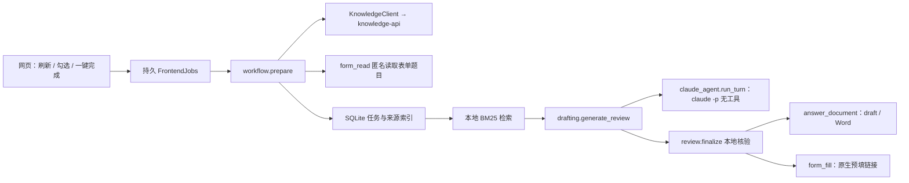

# 核心模块与持久化

## 模块

| 模块 | 职责 |
| --- | --- |
| `kb_client.py` | 课程数据的唯一来源。方法名沿用旧的 reader 接口（`courses`、`assignments`、`own_submissions`、`course_materials`、`announcements`），所以 `pending.discover_pending` 和 `form_fill.current_response_urls` 不关心数据从哪来。一个实例对每门课只读一次 `posts`，同一次运行看到一致的快照。 |
| `workflow.py` | `sync_course` 把一门课的帖子、附件文档、未挂在帖子上的资料库文档（录像、笔记）写入本机检索库；`prepare_assignment` 组装资料包；`prepare` 是公共入口。 |
| `claude_agent.py` | 一次无工具的 `claude -p --bare` 回合：stdin 传入文字和 base64 页图，stdout 读 stream-json，返回 `structured_output`。API 密钥通过子进程环境变量传入；没有密钥、模型或工具不一致时在发出请求前停止。也处理暂停、超时和用量上限。 |
| `api_key.py` | 网页设置的 Claude API 密钥：格式检查、向 Anthropic 验证、以 0600 权限保存，对外只给出末尾 4 位。 |
| `drafting.py` | 组装提示词与证据预算，调用 `claude_agent`，用 `accept_model_result` 核验并落盘；缓存与复用规则不变。 |
| `ui_jobs.py` / `webapp.py` | 持久任务与 HTTP 适配层。`webapp` 同时服务本机令牌访问和 `yishuapp.com/classroom/` 前缀下的公网访问。 |
| `form_fill.py` | 核验答案后生成原生预填链接。服务器上不打开浏览器，状态记为 `prefill_ready`，由用户在结果里点开。 |
| `document_fill.py` / `auth.py` / `google_read.py` | 后续版本的 Google 文档自动填写；当前运行路径不调用。 |

## 资料库数据如何变成证据

- 帖子：`coursework:<id>`、`material:<id>`、`announcement:<id>`，正文和附件列表按 1,600 字切段。
- 帖子附件：`file:<Drive 文件 ID>`。`knowledge-api` 的 `files` 映射给出对应的资料库文档；不存在或状态不是 `ready` 的列为 `warnings`。
- 资料库中未挂在任何帖子上的文档、笔记、录像：`kb:<DOC>`。
- 每段的 `locator` 形如 `第3页 · kb:4362e087#7`，同一页切成多段时也唯一，并且可以直接用 `kb read 4362e087#7` 在小主机上找到原文。
- 页面图片由 `pages.py` 生成（`kb-pages` 阶段）：课件先用无界面 LibreOffice 转成 PDF（隐藏页也导出，保证第 N 页就是第 N 张），再用 pdfium 按长边 1280 像素渲染。当前作业附带的文件每页都渲染（每份最多 40 页）；其他资料只渲染“视觉页”：课件里有大于 30KB 的图片或图表的页，PDF 里一张图片占页面四分之一以上的页。
- 图片挂在同一页的第一段证据上；没有任何提取文字的页单独生成一段证据（locator 带“页面图片”）。按文档 ID、文件大小和修改时间、文字指纹、渲染参数缓存，课件不变就不会重新渲染。
- 发给模型时最多 60 张：先是当前作业自己的文件，再是和作业相关的资料，最后是其他资料，同一份内按页码排。每张图前加一行“页面图片 N：资料 · 第几页 [E:证据ID]”，没发出的图片在提示里列出。

证据 ID 按课程、来源、修订（内容指纹）和 locator 计算。资料库内容不变，ID 就不变，已有的 AI 结果可以复用；内容变化后旧结果失效。

## 前端与访问控制

- 本机访问：`Host` 必须是 `127.0.0.1:<port>`，需要随机 Bearer 令牌，写操作要求本机 `Origin`。
- 公网访问：`Host: yishuapp.com`，路径必须在 `/classroom/` 下，必须带 Cloudflare Access 添加的 `Cf-Access-Jwt-Assertion` 请求头（只检查存在，与状态页一致），写操作要求 `Origin: https://yishuapp.com`。前端用相对路径加载资源，并根据路径自动给接口加前缀。
- `PUT /api/settings/api-key` 只接受 `{"key": …}`，空字符串表示删除；任何接口都不返回完整密钥。
- 所有课程文字以 `textContent` 呈现；接口不接受命令、解释器、权限或任意文件路径。

## 缓存与恢复

Store 在 Git 外使用 SQLite WAL 和跨进程文件锁。键为阶段名与输入指纹的 SHA-256；状态为 running / done / failed / interrupted。新进程持锁后把遗留的 running 改成 interrupted，下次调用重做。done 的输出文件必须存在且 SHA-256 一致才复用。阶段有 `form-questions`、`kb-pages`、`review-preparation`。

来源索引只保留本次读取到的来源，资料库删除或撤下的内容不会作为旧证据留下。

## 审核与信任

模型只返回数据：答案、检查表、来源 ID、表单逐栏答案。`finalize` 检查来源是否仍在当前索引、引文是否逐字匹配、个人事实是否对应用户提供的索引，生成 checksum receipt。`generation.json` 记录实际模型、会话 ID、用量、输入来源与页图摘要。机械检查不判断主张是否被证据蕴含，不代替人工审阅。
